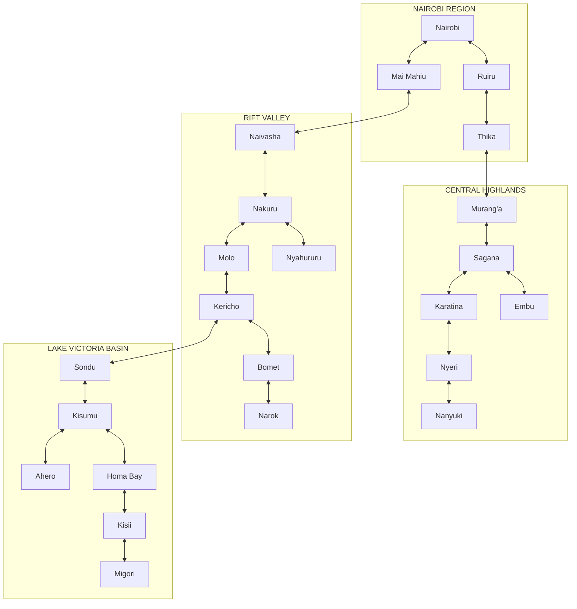
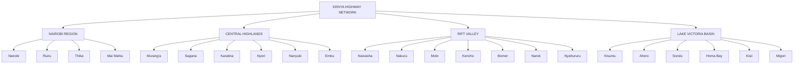
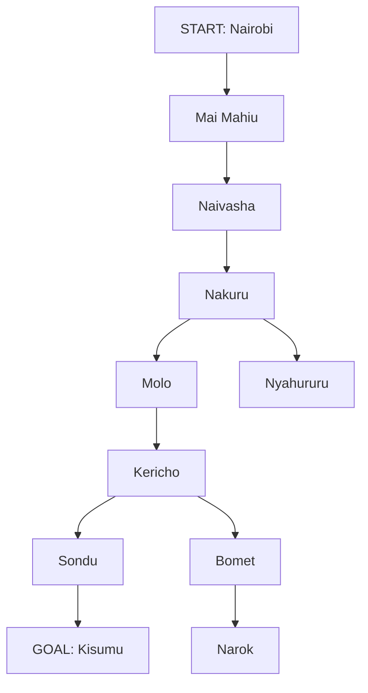
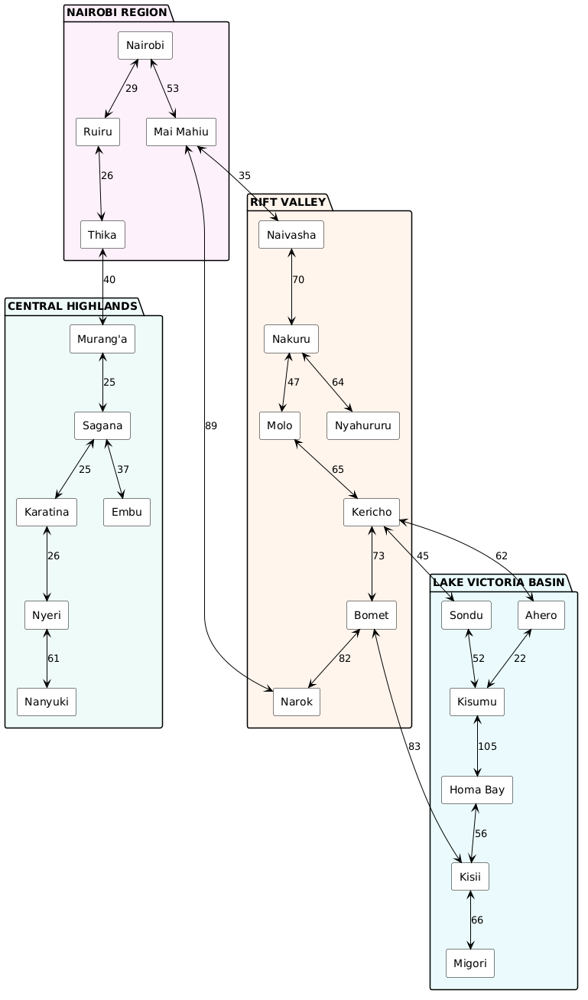
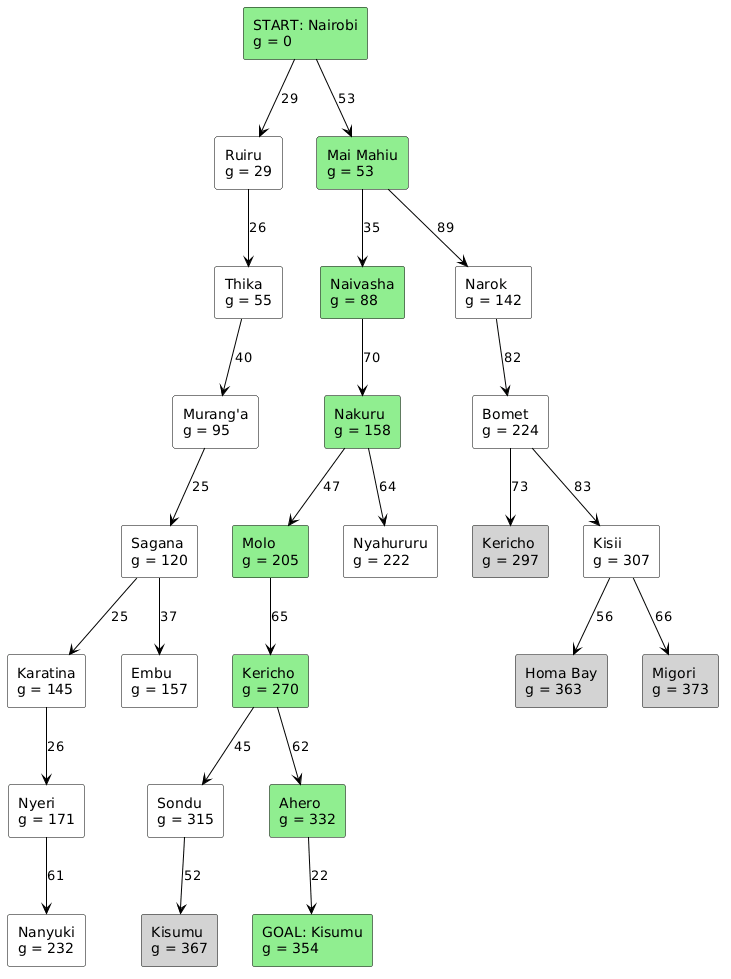
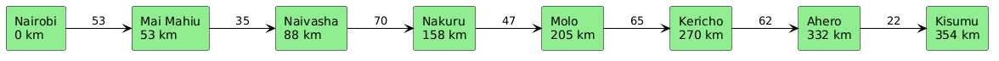

# Self-Driving Car Agent

## PEAS Description

| Component | Description |
|---|---|
| **Performance Measure** | Shortest distance |
| **Environment** | Vehicles, pedestrians, road signs, traffic lights |
| **Actuators** | Brakes, accelerator |
| **Sensors** | Radar, cameras, speedometer |

## Environment Properties

| Property | Type | Justification |
|---|---|---|
| **Observability** | Partially observable | Sensors have limited range, can't see behind trucks, and can't be sure of other drivers' intentions |
| **Determinism** | Stochastic | Weather and road incidents make outcomes unpredictable |
| **Episodic vs Sequential** | Sequential | Current actions affect future actions and decisions |
| **Static vs Dynamic** | Dynamic | The environment can change while the agent is still deciding |
| **Agents** | Multiagent | Other agents also operate within the same environment |

##  QUESTION 2 - DIRECTED GRAPH 

The directed graph represents the highway connections across major towns and cities in the Nairobi, Central Highlands, Rift Valley and Lake Victoria basin regions. 

## 2. GRAPH WITH ABSTRACTION

Abstraction simplifies the network by grouping the regions and removing unnecessary details. 

## 3. SEARCH TREE EXAMPLE

Start: Nairobi.
End: Kisumu

## 1. QUESTION 3 - OPTIMAL PATH FROM NAIROBI TO KISUMU

The path cost is the road distance (km) between towns, taken from Google Maps.

Path cost = sum of all road distances along the path.

### 2 Distances Between Towns

We added 3 more roads from Google Maps to give the trailer other route options: Mai Mahiu - Narok, Kericho - Ahero and Bomet - Kisii.

| From | To | Distance (km) |
|------|----|---------------|
| Nairobi | Ruiru | 29 |
| Ruiru | Thika | 26 |
| Nairobi | Mai Mahiu | 53 |
| Thika | Murang'a | 40 |
| Murang'a | Sagana | 25 |
| Sagana | Karatina | 25 |
| Karatina | Nyeri | 26 |
| Nyeri | Nanyuki | 61 |
| Sagana | Embu | 37 |
| Mai Mahiu | Naivasha | 35 |
| Mai Mahiu | Narok | 89 |
| Naivasha | Nakuru | 70 |
| Nakuru | Molo | 47 |
| Nakuru | Nyahururu | 64 |
| Molo | Kericho | 65 |
| Kericho | Bomet | 73 |
| Bomet | Narok | 82 |
| Kericho | Sondu | 45 |
| Kericho | Ahero | 62 |
| Sondu | Kisumu | 52 |
| Ahero | Kisumu | 22 |
| Kisumu | Homa Bay | 105 |
| Homa Bay | Kisii | 56 |
| Bomet | Kisii | 83 |
| Kisii | Migori | 66 |

### 3 Weighted Graph

### 4 Uniform Cost Search

We used Uniform Cost Search (UCS). It always expands the town with the lowest total distance so far, g(n). The first time Kisumu is picked, that path is the shortest.

| Step | Expanded | g(n) | Frontier |
|------|----------|------|----------|
| 1 | Nairobi | 0 | Ruiru (29), Mai Mahiu (53) |
| 2 | Ruiru | 29 | Mai Mahiu (53), Thika (55) |
| 3 | Mai Mahiu | 53 | Thika (55), Naivasha (88), Narok (142) |
| 4 | Thika | 55 | Naivasha (88), Murang'a (95), Narok (142) |
| 5 | Naivasha | 88 | Murang'a (95), Narok (142), Nakuru (158) |
| 6 | Murang'a | 95 | Sagana (120), Narok (142), Nakuru (158) |
| 7 | Sagana | 120 | Narok (142), Karatina (145), Embu (157), Nakuru (158) |
| 8 | Narok | 142 | Karatina (145), Embu (157), Nakuru (158), Bomet (224) |
| 9 | Karatina | 145 | Embu (157), Nakuru (158), Nyeri (171), Bomet (224) |
| 10 | Embu | 157 | Nakuru (158), Nyeri (171), Bomet (224) |
| 11 | Nakuru | 158 | Nyeri (171), Molo (205), Nyahururu (222), Bomet (224) |
| 12 | Nyeri | 171 | Molo (205), Nyahururu (222), Bomet (224), Nanyuki (232) |
| 13 | Molo | 205 | Nyahururu (222), Bomet (224), Nanyuki (232), Kericho (270) |
| 14 | Nyahururu | 222 | Bomet (224), Nanyuki (232), Kericho (270) |
| 15 | Bomet | 224 | Nanyuki (232), Kericho (270), Kisii (307) |
| 16 | Nanyuki | 232 | Kericho (270), Kisii (307) |
| 17 | Kericho | 270 | Kisii (307), Sondu (315), Ahero (332) |
| 18 | Kisii | 307 | Sondu (315), Ahero (332), Homa Bay (363), Migori (373) |
| 19 | Sondu | 315 | Ahero (332), Homa Bay (363), Kisumu (367), Migori (373) |
| 20 | Ahero | 332 | Kisumu (354), Homa Bay (363), Migori (373) |
| 21 | Kisumu | 354 | Goal reached |

Note: at step 15, Kericho through Bomet costs 224 + 73 = 297, so we kept 270 (through Molo). At step 20, Kisumu through Ahero (332 + 22 = 354) replaced Kisumu through Sondu (367).

### 5 Search Tree

Green = optimal path, grey = more expensive paths that were dropped.

### 6 Route Comparison

| Route | Path | Distance (km) |
|-------|------|---------------|
| 1 | Nairobi > Mai Mahiu > Naivasha > Nakuru > Molo > Kericho > Ahero > Kisumu | 53 + 35 + 70 + 47 + 65 + 62 + 22 = **354** |
| 2 | Nairobi > Mai Mahiu > Naivasha > Nakuru > Molo > Kericho > Sondu > Kisumu | 53 + 35 + 70 + 47 + 65 + 45 + 52 = 367 |
| 3 | Nairobi > Mai Mahiu > Narok > Bomet > Kericho > Ahero > Kisumu | 53 + 89 + 82 + 73 + 62 + 22 = 381 |
| 4 | Nairobi > Mai Mahiu > Narok > Bomet > Kericho > Sondu > Kisumu | 53 + 89 + 82 + 73 + 45 + 52 = 394 |
| 5 | Nairobi > Mai Mahiu > Narok > Bomet > Kisii > Homa Bay > Kisumu | 53 + 89 + 82 + 83 + 56 + 105 = 468 |

### 7 Optimal Path

**Nairobi > Mai Mahiu > Naivasha > Nakuru > Molo > Kericho > Ahero > Kisumu = 354 km**

It is the shortest route and it also uses the main highways, which suits a heavy trailer better than the Narok - Bomet road.

### References

- Distances: Google Maps (https://www.google.com/maps)
- All diagrams in this section were generated using PlantUML (https://plantuml.com). The source files are in the `diagrams` folder.

---

## Our Team

