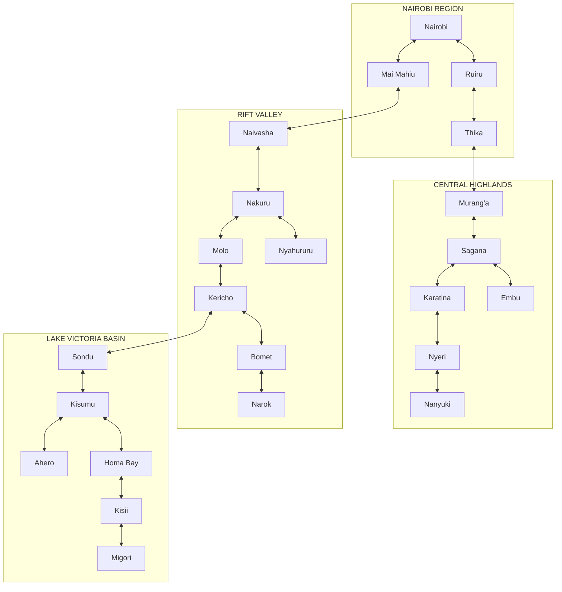
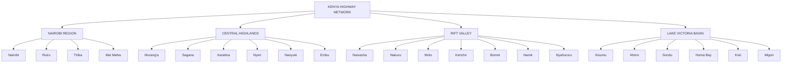
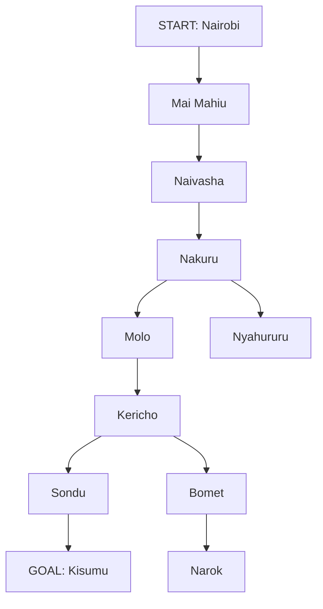

## 1. QUESTION 2 - DIRECTED GRAPH 

The directed graph represents the highway connections across major towns and cities in the Nairobi, Central Highlands, Rift Valley and Lake Victoria basin regions. 

## 2. GRAPH WITH ABSTRACTION

Abstraction simplifies the network by grouping the regions and removing unnecessary details. 

## 3. SEARCH TREE EXAMPLE

Start: Nairobi.
End: Kisumu

